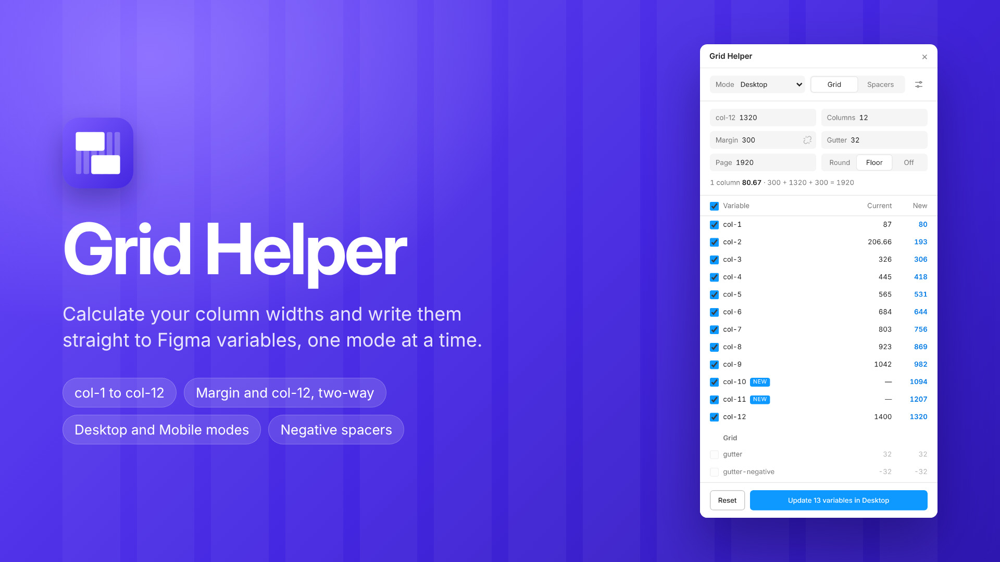

# Grid Helper

A Figma plugin that calculates your column widths and writes them to your Figma variables, one mode at a time.

Set the container width (col-12), the number of columns and the gutter. Grid Helper works out col-1 to col-12 for the selected mode, shows the current and new value of every variable, and writes only what you tick.



## Features

- **Columns:** calculates col-1 to col-12 from col-12, columns and gutter, per variable mode (for example Desktop and Mobile).
- **Two-way margin:** page width = margin + col-12 + margin. Type in either field and the other follows.
- **Aliases stay intact:** a margin linked to the gutter follows it and sets the container width. Split it or link it again with one click.
- **Negatives:** keeps the negative gutter and negative spacers (`spacers/negative/N`) in sync across all modes.
- **Missing variables:** creates missing col variables, from col-12 down to col-1.
- **Any file:** pick your own variables from a searchable list in Settings, or create a starter set in an empty file.
- **Safe:** nothing is written until you press Update, and every update is one undo step.

## Install

- **From the Figma Community:** search for “Grid Helper”, or use the link on the listing.
- **From this repo (development):** Figma desktop → Plugins → Development → Import plugin from manifest… → pick `manifest.json`.

## Quick start

1. Run Grid Helper in a file.
2. **No grid variables yet?** Click *Create grid variables*. It adds page width, columns, col-1 to col-12, gutter, margin and spacers 1–15 with negatives, in a new “Grid” collection with Desktop and Mobile modes (or in a collection you pick).
3. **Already have variables with other names?** Open Settings (the sliders icon) and pick each one from the list (or type the name). A status line under each field shows whether it was found. Changed or added variables while the plugin is open? Press *Reload* in Settings. The names are saved in the file, so your team gets them too.
4. Pick a mode, change col-12, margin, gutter or columns, tick the rows you want and press Update.

## How it calculates

```
column    = (col-12 − (columns − 1) × gutter) / columns
col-N     = N × column + (N − 1) × gutter      (N ≥ columns → col-12)
margin    = (page width − col-12) / 2           (or col-12 = page width − 2 × margin)
gutter-negative = −gutter
```

Rounding: **Floor** (default; stacked spans never exceed col-12), **Round** (nearest px) or **Off** (2 decimals).

Arrow keys step a value by 1; hold Shift to step by 10.

## Default variable names

| Setting | Default |
|---|---|
| Column prefix (col-12 is the container) | `grid/col/col-` |
| Number of columns | `grid/col/columns` |
| Margin | `grid/margin/margin` |
| Gutter | `grid/gutter` |
| Negative gutter | `grid/gutter-negative` |
| Page width | `grid/page/width` |
| Spacer prefix | `spacers/` |
| Negative spacer prefix | `spacers/negative/` |

## Aliases

- Aliased variables are never overwritten. They show `→ target` and follow their alias in the preview.
- When margin is aliased, it sets the container: `col-12 = page width − 2 × margin`, and the col-12 field shows `auto`.
- The link icon in the margin field splits a linked margin from its alias (written as a fixed number) or links a plain margin to gutter (written as an alias).
- An aliased col-12, gutter or columns locks its input; change the variable it points to instead.

## Notes

- New col variables in an existing set are added at the end of their group, because Figma's plugin API can't reorder variables. Drag them into place once in the variables panel.
- On Figma plans that allow one mode per collection, the starter set is created with a Desktop mode only.
- Grid Helper has no network access. It stores your variable names in the file (plugin data) and the last used mode on your device (client storage). Nothing leaves Figma.

## License

MIT
